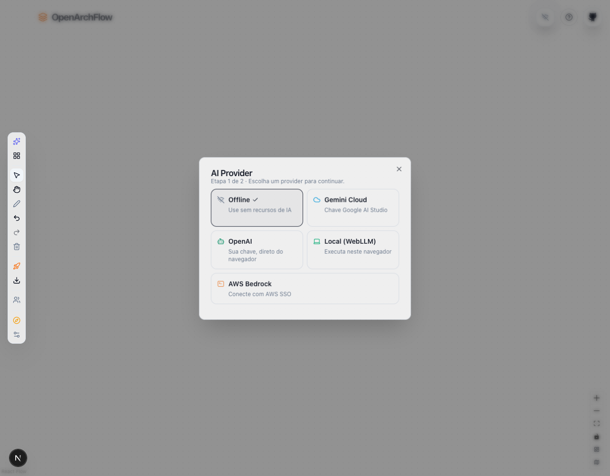
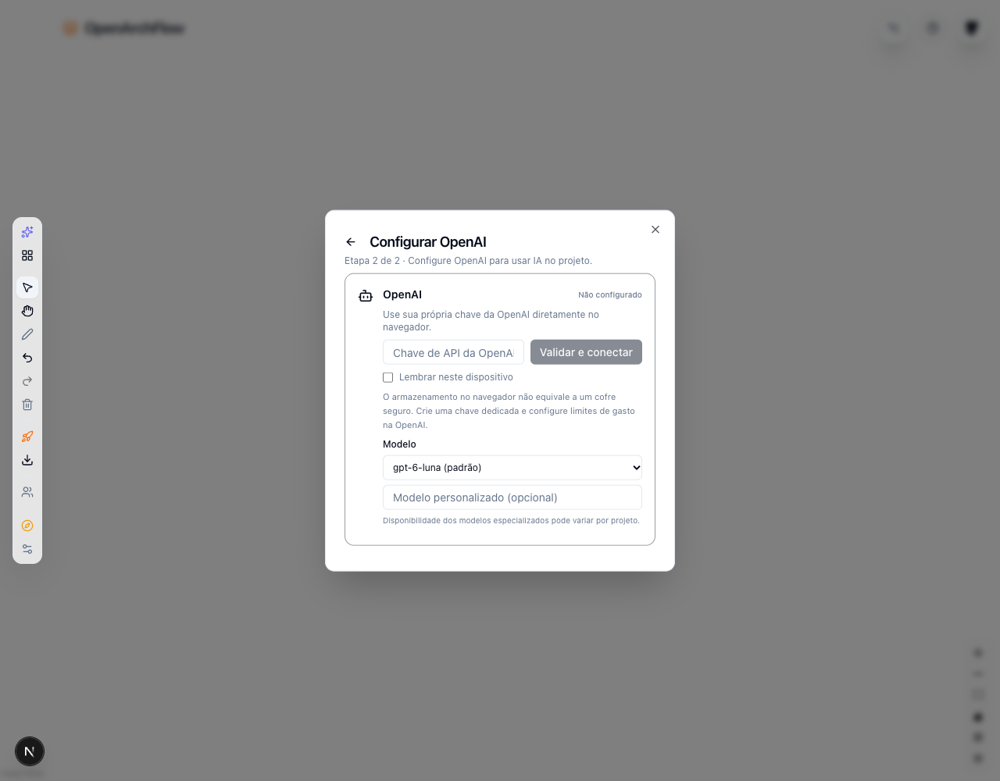
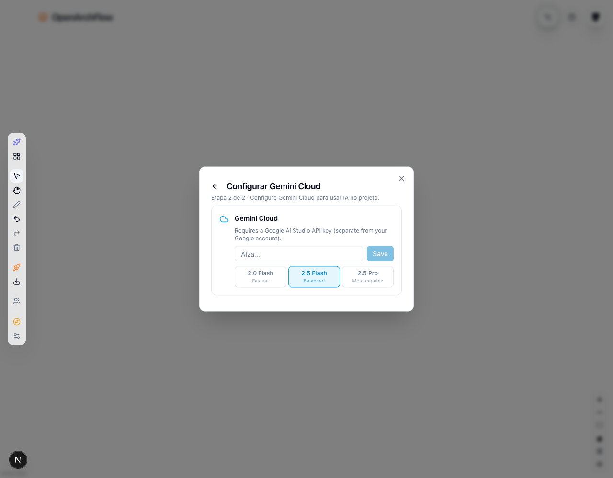
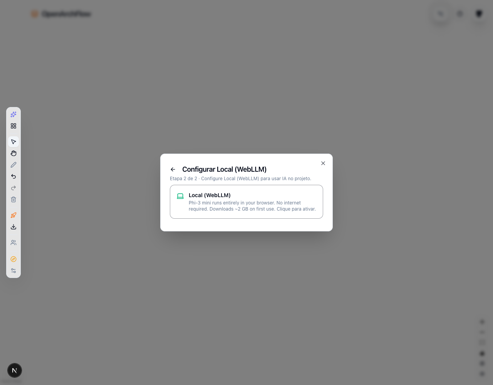
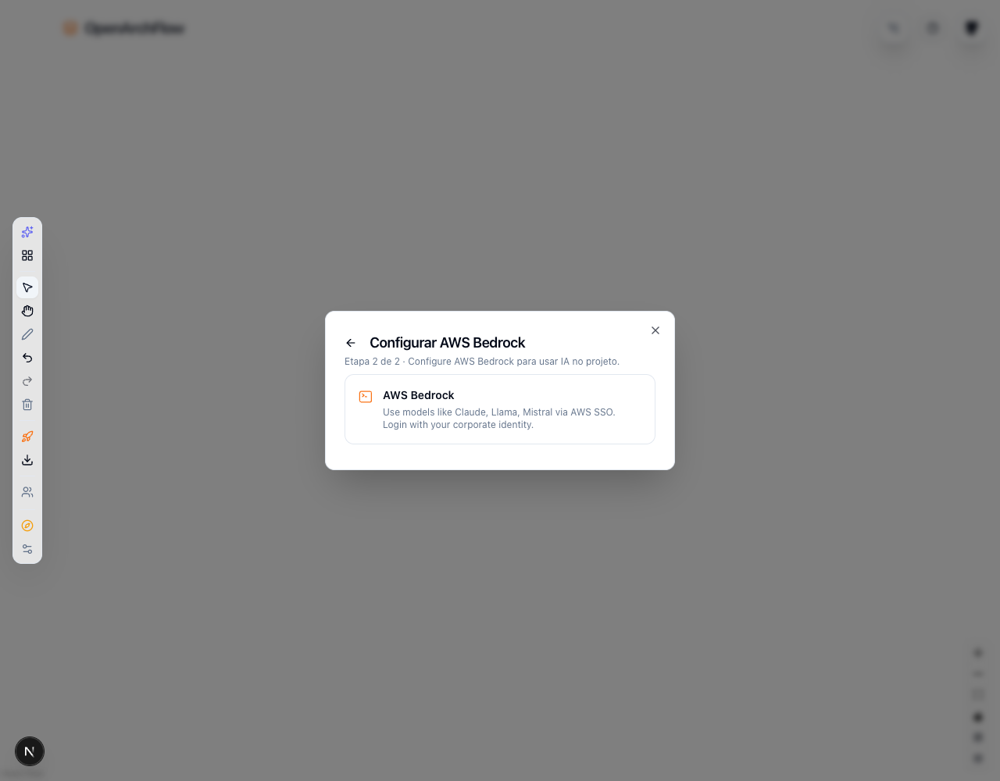
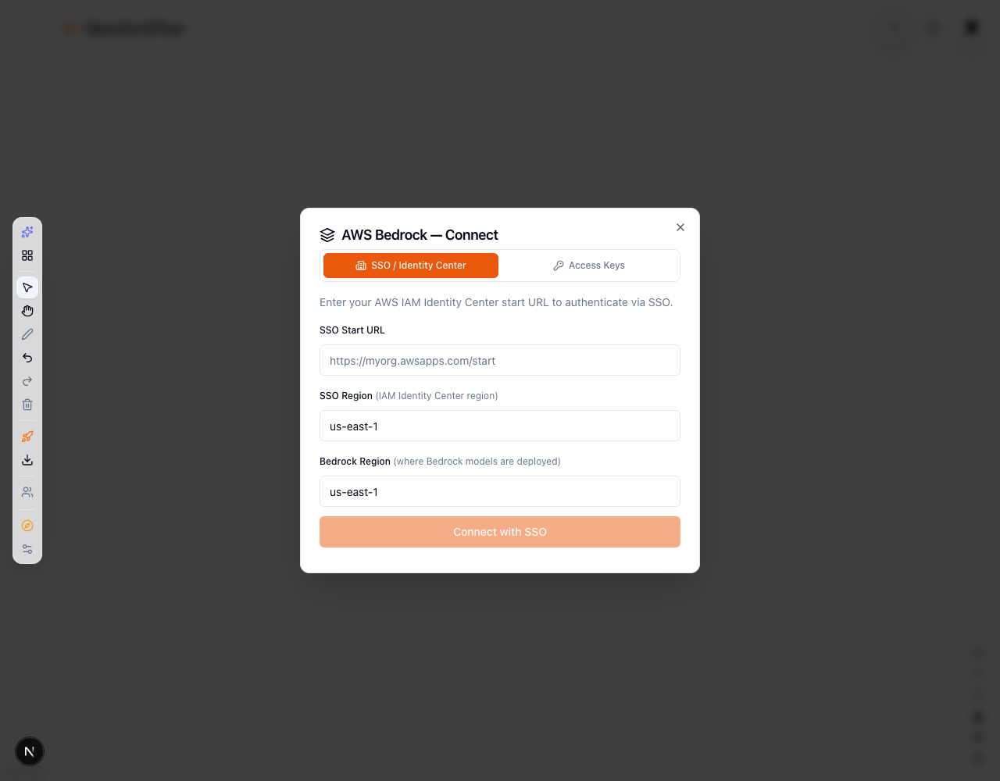
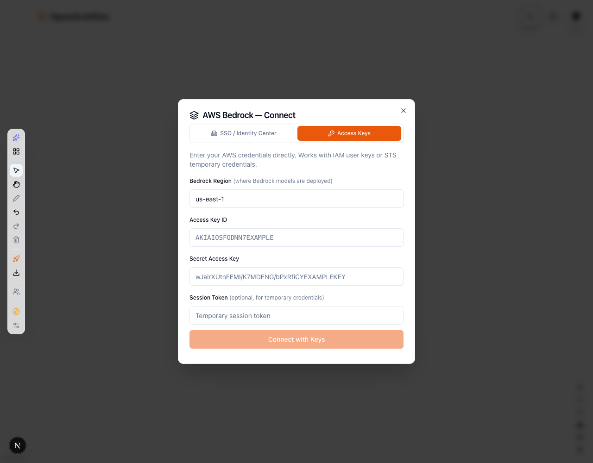

# AI Provider setup flow

## Summary

- Add OpenAI as a native BYOK provider. Requests go directly from the browser to OpenAI using the user's API key.
- Reorganize AI Provider into a guided two-step flow: choose a provider, then configure it.
- Keep the existing Gemini, Local WebLLM, AWS Bedrock, and Offline options.
- Keep the OpenAI key in session memory by default; “Lembrar neste dispositivo” opts into local browser storage.
- Validate OpenAI credentials with `GET /v1/models`, map provider errors, and validate structured architecture/Terraform responses before applying them.

## Validation

- ESLint passed.
- TypeScript check passed.
- 15 OpenAI provider tests passed.
- Production build passed; existing PWA cache-size and missing Upstash configuration warnings remain.

## Security notes

- No server proxy or environment variable is used for the OpenAI key.
- Browser storage is not a secure vault. Use a dedicated API key with minimum permissions and spending limits.

## Screenshots

### Provider selection

### OpenAI configuration

### Gemini Cloud configuration

### Local WebLLM

### AWS Bedrock

### AWS Bedrock authentication

### AWS Bedrock access keys

